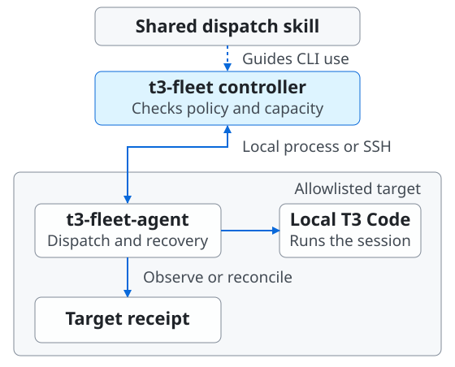

# T3 Brigade Fleet

T3 Brigade Fleet dispatches T3 Code sessions across an allowlisted set of
machines. It gives operators of several T3 Code hosts one CLI to start work,
track requests, and recover an uncertain dispatch.

## Install

Use Python 3.11 or newer. The package has no third-party Python runtime
dependencies. For evaluation, install from the public repository:

```bash
pipx install git+https://github.com/escoffier-labs/t3-brigade-fleet.git
```

- `t3-fleet` is the controller CLI for dispatch, status, and recovery.
- `t3-fleet-agent` talks to T3 Code on the target.
- `t3-lane` is the [local lane client](docs/lane-client.md) for inspecting and
  operating a T3 Code thread.

For deployment, use a reviewed commit and an operator-owned pin. The
[pinned runtime builder](scripts/build-public-runtime.py) builds and verifies a
wheel against the pin's Git commit, tree, and package contract. The
[installer](scripts/install-public-runtime.py) can plan and verify changes
against an existing layout. In-place pin upgrades support POSIX source wrappers
and retain a transaction record for rollback. The installer expects two
managed commands in existing virtual environments and Windows user-site
layouts. Prepare a separate install before switching those launchers to a
wheel that includes `t3-lane`. See the
[pinned runtime procedure](docs/deployment.md#pinned-runtime-artifacts) for the
required interpreter flags, artifact checks, and rollback steps.

## Quick start

Try the shipped offline example from a source checkout after installing
`t3-fleet`:

```bash
git clone https://github.com/escoffier-labs/t3-brigade-fleet.git
cd t3-brigade-fleet
chmod 600 examples/local.example.toml
T3_FLEET_CONFIG="$PWD/examples/local.example.toml" t3-fleet doctor
```

The example points at an intentionally unavailable local agent. The diagnostic
exits successfully with `blocked_offline` because the target cannot accept work.
For a live target, follow the
[deployment prerequisites](docs/deployment.md#before-a-real-dispatch), then
[submit and wait for a request](docs/quickstart.md).

## How it works



The controller checks policy and capacity, obtains Brigade authority, and
passes the request to the target agent. The agent talks to T3 Code over
loopback, and T3 Code runs the session. The target records a receipt keyed to
the request so later commands can match the correct work.

The target agent's observer checks T3 Code snapshots and refreshes receipts
and reservation status. If a transport failure leaves a dispatch outcome
unknown, `t3-fleet recover` uses target evidence to reconcile the existing
request without replaying the prompt. The
[recovery guide](docs/recovery.md) explains when capacity remains reserved.

The [shared dispatch skill](skills/t3-fleet-dispatch/SKILL.md) guides agents
through choosing a route, checking readiness, and handling approvals and
recovery with the CLI.

## Configuration

Start with the [fleet TOML example](examples/fleet.example.toml). Keep the
active file outside the checkout and set it to mode `0600` on Unix. It defines
allowed hosts and transports, per-host repository paths, and capacity limits.
Configure and authenticate T3 Code on each target before dispatching.

Install a compatible Brigade CLI separately on the controller and each target.
With enrollment off, dispatch still needs Brigade model admission for an
explicit logical seat. With enrollment required, the Brigade Hub owns routing
and reservations through the CLI. Keep credentials and operator pins in
protected storage. See [deployment](docs/deployment.md) and the
[security model](docs/security-model.md).

## BrigadeStack integration

[BrigadeStack](https://github.com/escoffier-labs/brigadestack) calls an external
`t3-fleet` client for configured fleet work. The client calls the external
`brigade` CLI for model admission and enrolled reservation operations.

## Reference

- [Architecture](docs/architecture.md)
- [Wire schemas](schemas/)
- [Changelog](CHANGELOG.md)
- [Contributing](CONTRIBUTING.md)
- [Apache-2.0 license](LICENSE)
