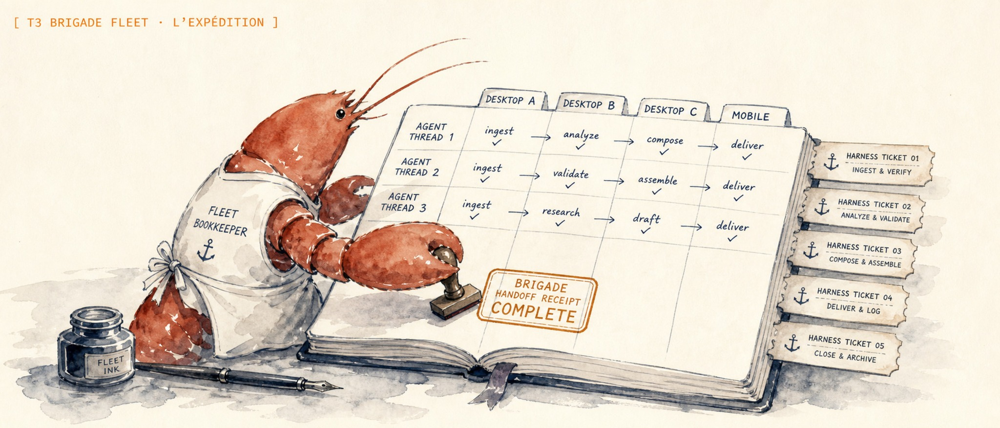
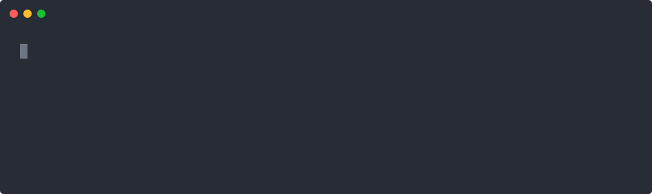

<p align="center">
  
</p>

<h1 align="center">T3 Brigade Fleet</h1>

<p align="center">
  <strong>Dispatch T3 Code sessions across an allowlisted fleet, with Brigade receipts for operators running agents on more than one machine.</strong>
</p>

<p align="center">
  <a href="https://brigade.tools">Brigade</a> &middot;
  <a href="docs/architecture.md">Architecture</a> &middot;
  <a href="#try-it-in-60-seconds">Quickstart</a> &middot;
  <a href="docs/security-model.md">Security</a>
</p>

<p align="center">
  
  
  
</p>

One controller, reviewed targets, stable request IDs, and a closed recovery path when a connection drops during dispatch.

<p align="center">
  
</p>

<p align="center"><em><code>t3-fleet submit</code> starts an allowlisted session and <code>wait</code> reports its terminal result.</em></p>

## What it does

`t3-fleet` sends a prompt to T3 Code on an allowlisted target, reserves that repository, and tracks the request until it succeeds, fails, pauses, or enters an unknown state. It gives operators with several machines one controller surface without giving that controller arbitrary remote-command access. T3 Code still owns the coding session, while Brigade admits the selected model and records fleet policy and verification evidence.

The project is experimental and pre-1.0. Pin the commit you deploy until the public interfaces settle.

## Install

Python 3.11 or newer is required. The Python runtime has no third-party dependencies.
Real dispatch also requires a compatible, separately installed Brigade CLI and
operator-configured model admission on the controller and every target.

```bash
pipx install git+https://github.com/escoffier-labs/t3-brigade-fleet.git
```

This installs two commands:

- `t3-fleet` is the controller you run from your workstation.
- `t3-fleet-agent` is the per-target agent invoked through the configured transport.

## Try it in 60 seconds

The shipped local example validates the controller without contacting an arbitrary SSH alias:

```bash
git clone https://github.com/escoffier-labs/t3-brigade-fleet.git
cd t3-brigade-fleet
pipx install .

export T3_FLEET_CONFIG="$PWD/examples/local.example.toml"
chmod 600 "$T3_FLEET_CONFIG"
t3-fleet doctor
```

The placeholder agent is deliberately unavailable. After parsing the config,
doctor reports the allowlisted target as blocked without network discovery:

```json
{"schema":"t3-fleet.result.v1","action":"doctor","state":"blocked_offline","hosts":[{"host":"controller-a","state":"blocked_offline","server_version":null}]}
```

The diagnostic exits `0` because it completed the check. `blocked_offline` means
no target is ready and no work can launch. Invalid config still exits `2`.
Replace the placeholder only after reviewing a real target and completing the
[deployment prerequisites](docs/deployment.md). The full path from config through `submit` and `wait` is in [the quickstart](docs/quickstart.md).

## Required admission setup

Before real dispatch, the operator must configure Brigade on the controller and
all targets, enroll each node through its approved credential route, and make a
logical seat available in the current roster for the `t3-fleet` consumer. Check
`brigade fleet models --help` for the installed helper contract and confirm the
seat's provider binding with the operator. The package ships no credentials,
roster, or standalone provider fallback.

With `[policy] enrollment = "off"`, submit requires an explicit logical `seat`
and still obtains Brigade model admission. With `enrollment = "required"`,
configure canonical repository identities and the Hub policy first. Prefer
`--host auto` without a seat override. Explicit hosts or seats then require
`--override-reason`. Missing or denied admission fails closed. See
[deployment](docs/deployment.md) for target setup and upgrade limits.

## Dispatch a session

This example uses policy enrollment off and a placeholder seat. Replace the
seat and revision with reviewed values. Submit accepts flags or one JSON object
on standard input. The Brigade catalog path requires a protected prompt file
and rejects inline prompt text. Prompt text stays out of process arguments.

```bash
t3-fleet submit \
  --host target-a \
  --repository example-repo \
  --seat example-seat \
  --source-revision 0123456789abcdef0123456789abcdef01234567 \
  --title "Verify the public API" \
  --runtime-mode approval-required \
  < prompt.txt
```

The result includes a stable `request_id` and the T3 Code `thread_id`. Use that request ID for every later action:

```bash
t3-fleet wait --request-id <request-id> --timeout 600 --include-output
```

## Who owns what

| System | Responsibility |
|---|---|
| [T3 Code](https://github.com/pingdotgg/t3code) | Runs the model, owns the working tree, manages approvals, and emits the turn stream |
| `t3-fleet` | Enforces the target allowlist, transports requests, reserves repositories, and reconciles unknown outcomes |
| [Brigade](https://brigade.tools) | Admits models, routes enrolled work, manages reservations, and records verification receipts |

The controller never connects directly to a remote T3 Code server. It talks to the target agent, and that agent talks to its local T3 Code instance.

## Public commands

- `t3-fleet doctor` checks whether each allowlisted target is reachable and registered.
- `t3-fleet capacity` reports active sessions and limits per target.
- `t3-fleet submit` starts a T3 Code session on a selected target and repository.
- `t3-fleet status` reads a request without waiting.
- `t3-fleet wait` polls until the request is terminal or needs attention.
- `t3-fleet followup` sends another prompt to an existing session.
- `t3-fleet approve` returns a decision for a pending approval.
- `t3-fleet answer` answers a pending structured input request.
- `t3-fleet interrupt` requests a graceful stop.
- `t3-fleet recover` reconciles a request whose dispatch outcome is unknown.
- `t3-fleet tick` drains previously authorized queued work and renews local target reservations.

Most commands accept flags or a single JSON object on standard input. `answer` is JSON-stdin-only. The request and result contracts live in [`schemas/`](schemas/).

## Operator and integration commands

`settle-sweep` and `install-settle-timer` are operator-only commands. JSON
`invoke` rejects them. Settlement is disabled by default and requires an
operator to configure it. Do not install a timer as part of model-driven work.
`invoke` reads request JSON for integrations, while `brigade-invoke` reads only
the authorized Brigade tool-call journal. Neither bypasses admission or approval.

## Approval modes

`submit` and `followup` default to `approval-required`. Operator authorization
is also required for mutating actions, independently of runtime mode and model
admission. Reuse authorization only for its exact action and scope.

Use `approval-required` for public examples and ordinary dispatch. It preserves
T3 permission prompts. Other runtime modes require separate operator review.
A runtime mode never grants model admission or approves an unrelated action.

Read the [security model](docs/security-model.md) before changing the default.

## Queue and attention

A controller may opt into `[outbox] enabled = true`. Only submits with
`--allow-queue` may defer a known pre-launch capacity or offline block. A
`pending_autotick` result has a `job_id`, not evidence of a running session.
`t3-fleet tick` drains a bounded slice under the original approval, revalidating
policy and capacity. It also renews reservations owned by this local target.
An ambiguous acceptance stays held and is never retried. Inspect
`last_tick_at`, `queue_disposition`, and `queue_reason` in queue results.
`--allow-queue` cannot be combined with `--delegation-id`.

`needs_attention` results carry a bounded `pending_request`. Use its unchanged
`id` and `respond_with` to send an authorized approval or answer. Terminal
reservations cannot be resumed without new admission. See
[recovery](docs/recovery.md) for unknown results and retention limits.

## Windows targets

The PowerShell files under [`scripts/`](scripts/) are reference launchers for a headless T3 Code service and `t3-fleet-agent` on Windows. They are not installed by `pipx` and should be reviewed before use.

## Why not manual SSH or a generic queue?

Manual SSH and one T3 Code window per machine are reasonable when one operator has one or two targets. They do not provide a shared request identity, repository leases, target-side receipts, or a recovery command for a connection that drops after the remote session starts.

A generic queue can distribute jobs across machines. It does not know T3 Code thread, approval, follow-up, and input semantics. `t3-fleet` exposes those operations and refuses arbitrary shell execution.

If one T3 Code server already covers every machine you use, start with T3 Code alone. Add this dispatcher when you need an allowlisted controller across separate T3 Code targets or want Brigade receipts around that work.

## What T3 Brigade Fleet is not

T3 Brigade Fleet is not a hosted control plane, a model provider, or a replacement for T3 Code or Brigade. It does not synchronize private memory stores, copy credentials between devices, inspect prompt contents, or accept arbitrary remote commands. Fleet configuration, authentication, and target approval remain operator-owned.

## Docs

- [Architecture](docs/architecture.md)
- [Quickstart](docs/quickstart.md)
- [Local lane client](docs/lane-client.md)
- [Security model](docs/security-model.md)
- [Recovery](docs/recovery.md)
- [Deployment and upgrades](docs/deployment.md)
- [Contributing](CONTRIBUTING.md)
- [Security policy](SECURITY.md)
- [Changelog](CHANGELOG.md)

## License

Apache-2.0. See [LICENSE](LICENSE). An [Escoffier Labs](https://github.com/escoffier-labs) project for operators using [Brigade](https://brigade.tools) and T3 Code. The public command is `t3-fleet`.
